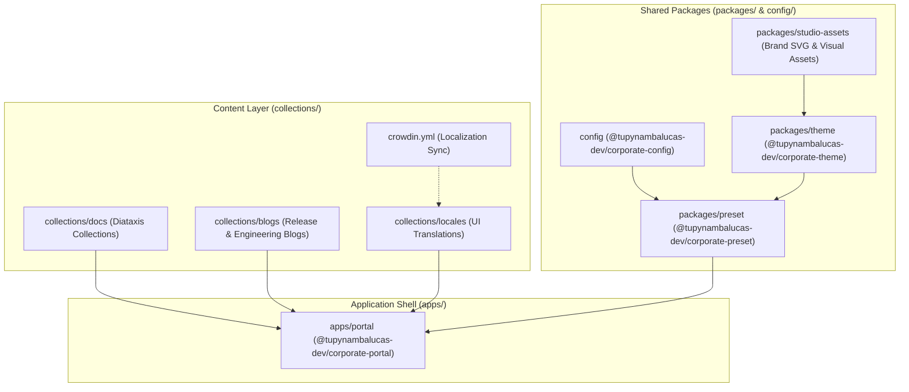

# Sovereign Documentation Hub (`@tupynambalucas-dev/docs`)

Centralized technical documentation portal, engineering knowledge base, and multi-instance Docusaurus v3 monorepo for the `tupynambalucas-dev` organization. Powered by Docusaurus 3.10, React 19, TypeScript, pnpm Workspaces, Turborepo, and Crowdin continuous localization.

> [!NOTE]
> **Production Portal:** Published continuously to Cloudflare Pages at [https://docs.tupynambalucas.dev](https://docs.tupynambalucas.dev).

---

## 1. Architecture Overview

`docs` operates as the sovereign documentation platform for organizational engineering guides, product references, and governance specifications. It implements a decoupled **Collections Architecture** where Markdown/MDX content (`collections/`) is separated from the Docusaurus application shell (`apps/portal`), reusable multi-instance plugin presets (`packages/preset`), custom theme components (`packages/theme`), and shared metadata (`config/`). All documentation collections adhere strictly to the **Diátaxis Framework** (`tutorials/`, `how-to-guides/`, `reference/`, `explanation/`).



```text
docs/
├── .agents/                 # Agent Mesh plugin bindings (plugins.json) and PreToolUse hooks
├── apps/
│   └── portal/              # @tupynambalucas-dev/corporate-portal (Docusaurus v3 web application)
├── collections/             # @tupynambalucas-dev/corporate-collections (MDX docs, blogs, locales)
├── config/                  # @tupynambalucas-dev/corporate-config (Centralized portal metadata)
├── packages/
│   ├── preset/              # @tupynambalucas-dev/corporate-preset (Multi-instance Docusaurus preset)
│   ├── studio-assets/       # Brand vector icons, logos, and visual tokens
│   └── theme/               # @tupynambalucas-dev/corporate-theme (Custom theme & MDX components)
├── AGENTS.md                # Sovereign Layer-1 AI agent context router
├── CHANGELOG.md             # Compiled release history
├── ROADMAP.md               # Compiled engineering roadmap
├── crowdin.yml              # Crowdin continuous localization configuration
├── LICENSE.md               # Apache License 2.0
├── package.json             # Root monorepo manifest and pipeline scripts
└── README.md                # Primary developer documentation
```

---

## 2. Subsystems & Navigation

| Subsystem / Workspace | Package / Scope | Documentation | Agent Context | Responsibilities |
| :--- | :--- | :--- | :--- | :--- |
| **`apps/portal`** | `@tupynambalucas-dev/corporate-portal` | [`apps/portal/README.md`](./apps/portal/README.md) | [`apps/portal/AGENTS.md`](./apps/portal/AGENTS.md) | Central Docusaurus v3 application shell, routing, and build scripts. |
| **`collections`** | `@tupynambalucas-dev/corporate-collections` | [`collections/README.md`](./collections/README.md) | [`collections/AGENTS.md`](./collections/AGENTS.md) | Diátaxis MDX documentation collections (`docs/`), blogs (`blogs/`), and UI locales (`locales/`). |
| **`packages/preset`** | `@tupynambalucas-dev/corporate-preset` | [`packages/preset/README.md`](./packages/preset/README.md) | [`packages/preset/AGENTS.md`](./packages/preset/AGENTS.md) | Custom Docusaurus preset orchestrating multi-instance docs and blog plugins. |
| **`packages/theme`** | `@tupynambalucas-dev/corporate-theme` | [`packages/theme/README.md`](./packages/theme/README.md) | [`packages/theme/AGENTS.md`](./packages/theme/AGENTS.md) | Custom Docusaurus theme components, navigation chrome, and styling tokens. |
| **`packages/studio-assets`** | `@tupynambalucas-dev/studio-assets` | [`packages/studio-assets/README.md`](./packages/studio-assets/README.md) | *(inherits root)* | Brand SVG marks, icons, and visual assets consumed by the documentation theme. |
| **`config`** | `@tupynambalucas-dev/corporate-config` | [`config/README.md`](./config/README.md) | [`config/AGENTS.md`](./config/AGENTS.md) | Shared TypeScript configuration package (`project.config.ts`). |
| **`.agents`** | Agent Customizations | [`.agents/README.md`](./.agents/README.md) | [`.agents/AGENTS.md`](./.agents/AGENTS.md) | `@tupynambalucas-dev/agent-mesh` plugin registrations and safety hooks. |

---

## 3. Environment & Secret Governance

Continuous deployment to Cloudflare Pages and automated localization synchronization with Crowdin use credentials managed through **Infisical**:

| Variable Name | Purpose | Execution Scope |
| :--- | :--- | :--- |
| `CLOUDFLARE_PAGES_TOKEN` | Authenticates static bundle deployments to Cloudflare Pages | CI/CD Pipeline (`prod` environment) |
| `CLOUDFLARE_ACCOUNT_ID` | Identifies the target corporate Cloudflare account | CI/CD Pipeline (`prod` environment) |
| `CROWDIN_PERSONAL_TOKEN` | Synchronizes source and localized MDX content with Crowdin | CI/CD Pipeline & Localization Workflows |

### Execution Modes

- **Meta-Repository Mode (`org-core`)**: When developing inside `org-core`, secrets cascade from the umbrella environment or root Infisical session.
- **Standalone Workspace Mode (`docs`)**: Execute commands with project-scoped Infisical credentials:
  ```bash
  infisical run --projectId <DOCS_PROJECT_ID> --env dev -- pnpm portal:dev
  ```

---

## 4. Getting Started

### Prerequisites

- **Node.js**: `>= 22.x`
- **pnpm**: `12.6.0` (configured with workspace catalogs)

### Installation & Local Startup

```bash
# 1. Clone the repository
git clone git@github.com:tupynambalucas-dev/docs.git
cd docs

# 2. Install workspace dependencies
pnpm install

# 3. Start local Docusaurus development server (http://localhost:3002)
pnpm portal:dev

# 4. Or start the local development server in Brazilian Portuguese (pt-BR)
pnpm portal:dev:pt
```

---

## 5. Development & Pipeline Scripts

| Command | Description |
| :--- | :--- |
| `pnpm portal:dev` | Starts `@tupynambalucas-dev/corporate-portal` local dev server on port `3002`. |
| `pnpm portal:dev:pt` | Starts `@tupynambalucas-dev/corporate-portal` local dev server in `pt-BR` locale. |
| `pnpm portal:build` | Builds the production Docusaurus static bundle via Turborepo. |
| `pnpm portal:preview` | Builds and serves the production bundle locally for verification. |
| `pnpm portal:clear` | Clears Docusaurus generated caches and build artifacts. |
| `pnpm portal:down` | Frees port `3002`. |
| `pnpm portal:typecheck` | Runs TypeScript validation across `portal`, `preset`, `theme`, and `collections`. |
| `pnpm portal:lint` | Runs ESLint & MDX validation across `portal`, `preset`, `theme`, and `collections`. |
| `pnpm portal:generate:changelog` | Compiles `CHANGELOG.md` from structured collection release entries. |
| `pnpm portal:generate:roadmap` | Compiles `ROADMAP.md` from structured collection roadmap entries. |
| `pnpm build` | Runs `turbo run build` across all workspaces. |
| `pnpm typecheck` | Runs `turbo run typecheck` across all workspaces. |
| `pnpm lint` | Runs `turbo run lint` across all workspaces. |

---

## 6. Governance & Contributing Standards

All documentation contributions must adhere to organizational and Docusaurus governance rules:

1. **Diátaxis Quadrant Structure**: Every technical article must belong to one of `tutorials/`, `how-to-guides/`, `reference/`, or `explanation/`.
2. **MDX v3 Parser Compliance**: Self-closing HTML tags must include a trailing slash (`<br />`), JSX comments must use `{/* ... */}`, and all code blocks must declare an explicit language tag.
3. **Crowdin Localization Barrier**: Never edit localized files inside `i18n/` directly; author source changes in the primary collection directories and synchronize via Crowdin.
4. **Cryptographic Commit Signing**: All Git commits and tags MUST be signed using SSH (`git commit -S -m "..."`).
5. **Conventional Commits & Zero-Emoji Invariant**: Commit messages must follow Conventional Commits v1.0.0, and emojis are strictly forbidden across all Markdown/MDX documents and commits.
6. **AI Agent Context**: Autonomous agents operating in this repository MUST read [AGENTS.md](./AGENTS.md) before modifying files.

---

## 7. License

Licensed under the [Apache License 2.0](./LICENSE.md). Copyright (c) 2026 tupynambalucas.dev.
